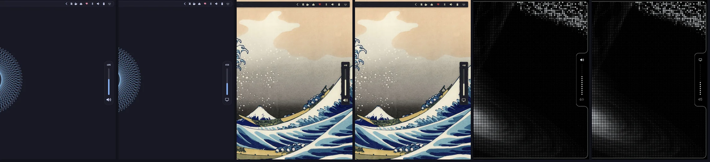

# Omarchy Edge OSD

[🇷🇺 Русский](README.ru.md)

The [Omarchy](https://omarchy.org) on-screen display (a clone of the stock `omarchy.osd`) where volume,
brightness and microphone levels are a vertical slider that slides out of the screen edge. With a solid bar
glued to the edge — for example the `frame` skin of
[omarchy-bar-skins](https://github.com/KamradSmeshnyavy/omarchy-bar-skins) — it grows out of the frame with
concave corners; otherwise it is a floating card with a gap and a shadow. Messages and media OSDs keep the
stock card. The OSD never takes clicks.



<!-- Demo video: repo-videos/omarchy-edge-osd.mp4 — drag it here when editing this file on GitHub -->

## Install

```sh
omarchy plugin add https://github.com/KamradSmeshnyavy/omarchy-edge-osd --enable
omarchy restart shell
```

Blur under a glass OSD (Hyprland Lua config):
`hl.layer_rule({ match = { namespace = "omarchy-osd" }, blur = true, ignore_alpha = 0.2 })`.

## Requirements

Omarchy 4 (Quattro) with its shell. Tested on Omarchy 4.0.6 with Quickshell 0.3.2.

- Nothing beyond Omarchy.
- Optional: the [Customizer](https://github.com/KamradSmeshnyavy/omarchy-customizer) — its Style presets (Flat, Glass, Fluent, DOT-MATRIX) write `~/.config/omarchy/style.json`, which this plugin follows; without it the defaults are used.
- DOT-MATRIX designs use the fonts shipped with the [Customizer](https://github.com/KamradSmeshnyavy/omarchy-customizer) (Doto, Space Grotesk, Space Mono); without them they fall back to the Omarchy font.

## Uninstall

```sh
omarchy plugin enable omarchy.osd      # switch back to the stock one first
omarchy plugin remove kamradsmeshnyavy.osd
omarchy restart shell
```

Your settings stay in `~/.config/omarchy/osd.json` — delete them by hand if you don't need them.

## Settings

`~/.config/omarchy/osd.json`, re-read live. The
[Customizer](https://github.com/KamradSmeshnyavy/omarchy-customizer) edits it under Windows → OSD.

```jsonc
{
  "osdStyle": "edge",       // edge | dotmatrix | stock
  "osdSide": "right",       // right | left
  "osdAlign": "center",     // center | top | bottom — along the edge
  "osdSize": "normal",      // compact | normal | large
  "osdShowValue": true,     // the percentage above the slider
  "osdTimeout": -1,         // ms; -1 — as sent by `omarchy osd`
  "osdFollowBar": true,     // colour, alpha, border, radius as the bar
  "osdAttach": "auto",      // auto | attached | floating
  "osdBackground": "background", "osdAlpha": 0.94, "osdRadius": 18
}
```

**Style tokens.** `~/.config/omarchy/style.json` (written by
[omarchy-customizer](https://github.com/KamradSmeshnyavy/omarchy-customizer) → Presets → Style) tunes the panels on top
of the bar: `elevation` 0–2 (shadows), `motion` (animation speed multiplier, 0 — none), `material`
(`auto` / `solid` / `glass`), `cornerScale` (0 — square corners), `typeface` (`shell` — Omarchy font, `profile` — the
sans of `~/.config/omarchy/fonts.json`, `hand` — handwritten Caveat; icons always stay on the Omarchy font).
`material` `paper` / `soft` / `brutal` / `bevel` / `glow` draws floating panels with `StyleCard.qml`: a sheet of
paper (torn edge, `texture` tile, tape), neumorphic relief, a thick border with a hard shadow, a retro bevel, neon glow. No file — the look as before.

Edits to the stock `Osd.qml` are marked `// edge:`. `BarStyle.qml` and `StyleCard.qml` are shared with
[omarchy-desktop-widgets](https://github.com/KamradSmeshnyavy/omarchy-desktop-widgets) and
[omarchy-drawer-notifications](https://github.com/KamradSmeshnyavy/omarchy-drawer-notifications).

## License

MIT (includes the stock Omarchy plugin it was cloned from).
